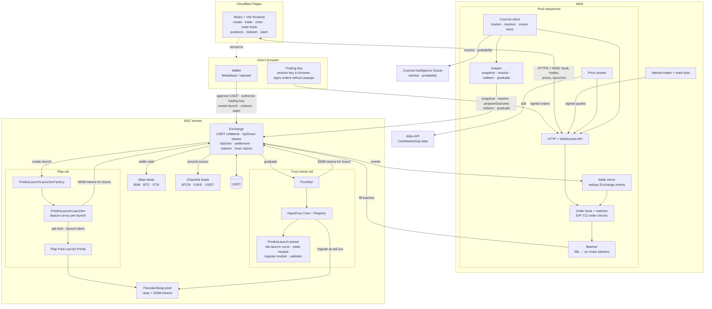

# PredictLaunch

**Launch memes on a prediction market. Losers get the meme, winners fund the initial pool.**

PredictLaunch is a memecoin launchpad on BNB Chain where a coin's starting liquidity is raised by an
"Up or Down" (or YES / NO) prediction market. Instead of buying a bonding curve, people bet on a question.
When the market settles, the winners give up a small cut of their payout to fund the coin's PancakeSwap pool,
and the losers get the memecoin. Nobody leaves with nothing.

> Setup, scripts, deployment and internals are in [DEVELOPER.md](DEVELOPER.md).
> Interfaces are in [SPEC.md](SPEC.md).

## Overview

A creator opens a launch by choosing:

- **The question.** Either a price question on an [Atlas Oracle](#coinmarketcap--atlas)
  feed ("Will BTC be above $95,000 at 18:00?") or a real-world YES / NO question matched to a
  [Cournot](#cournot-integration) market ("Will it rain in Boston on Nov 26, 2026?").
- **The settlement time**, a **cut** (10–30%) and a **target** (at least 3,000 USDT).
- **The coin**: name, symbol, logo, and where it launches: [Flap](#flap) (default) or
  [Four.meme](#fourmeme-openfour) through our own OpenFour preset.

Traders buy Up or Down shares on an order book. One Up plus one Down share is always backed by exactly 1 USDT
held by the Exchange contract, so the market is fully collateralised. Matching runs off-chain for speed;
fills settle on-chain in batches.

At settlement:

| | Target reached | Target missed |
|---|---|---|
| Winners | paid **1 − cut** per share | paid **1.00** per share |
| The cut | seeds the PancakeSwap pool with 500M tokens | not taken |
| Losers | share the other **500M tokens** | get nothing (it was a normal bet) |
| The coin | launches (1B supply) | no coin |

### Example: one launch, end to end

Launch: **"BTC above $95,000 at 18:00?"**, coin **$MOON**, cut **20%**, target **3,000 USDT**, on Flap.

1. **Trading.** Over the market's life, traders buy shares. Each matched pair locks 1 USDT in the Exchange.
   By settlement, **20,000 pairs** exist: 20,000 USDT is locked.
   - Alice buys 1,000 **Up** at 60¢ and pays **600 USDT**.
   - Bob buys 1,000 **Down** at 40¢ and pays **400 USDT**.
2. **Settlement.** At 18:00 the Exchange reads the BTC/USD Atlas feed on-chain: BTC is at $95,800. **Up wins.**
3. **The raise.** Cut × pairs = 20% × 20,000 = **4,000 USDT**. That is above the 3,000 USDT target, so the
   launch graduates.
4. **Winners are paid.** Every Up share redeems for 0.80 USDT. Alice gets **800 USDT** (+200).
5. **The coin launches.** Our Launcher Factory creates $MOON through Flap's Pool Launch Portal (1B supply,
   `…7777` address). **4,000 USDT + 500M $MOON** seed a PancakeSwap pool, so the opening price is
   4,000 / 500M = 0.000008 USDT.
6. **Losers get the meme.** Down holders share the other 500M $MOON pro rata. Bob holds 1,000 of 20,000 Down
   shares, so he claims **25M $MOON**, worth about **200 USDT** at the opening price. He lost the bet, but he
   holds the coin from its first block, and so do all the other losers.

```
          20,000 USDT locked (20,000 Up + 20,000 Down shares)
                               │
                  settle on Atlas BTC/USD: Up wins
                               │
           ┌───────────────────┴───────────────────┐
   80% → Up holders                    20% cut = 4,000 USDT ≥ target
   16,000 USDT (0.80 per share)                   │
                                   Flap Portal → $MOON, 1B supply
                                       ┌──────────┴──────────┐
                     PancakeSwap pool: 4,000 USDT      500M $MOON → Down holders,
                     + 500M $MOON (LP)                 pro rata to their shares
```

Had the pairs been only 10,000 (raise 2,000 USDT, under target), Up holders would get 1.00 each, Down holders
nothing, and no coin would launch.

## Architecture



**Frontend: Cloudflare Pages.** The React app is a static build served from Cloudflare's edge, with no
server of its own. It reads live data from the sequencer over HTTPS and WebSocket (`VITE_API_URL`) and sends
transactions to BSC through the user's wallet. One wallet signature authorizes a trading key in the browser,
which then signs every order without a wallet popup.

**Sequencer: AWS.** One Rust service runs the off-chain half of the exchange:

| Component | Role |
|---|---|
| HTTP + WebSocket API | launches, book, trades, prices, positions, Cournot endpoints; pushes live updates |
| Order book + matcher | checks EIP-712 signatures and balances, matches Up/Down orders instantly and gaslessly |
| Batcher | packs fills into batches and submits them to the Exchange |
| State mirror | replays Exchange events so balances and launches match the chain |
| Keeper | at settlement time: Atlas snapshot or Cournot resolve, then redeem winners and graduate the coin |
| Price stream | polls the Atlas API (CoinMarketCap data) for live charts |
| Cournot client | matches questions, opening probability, market tracking, settlement evidence |

The market-maker and seed bots run alongside it on AWS and quote through the same public API as any user.

**Contracts: BSC testnet.** The Exchange holds all collateral and pays every winner and loser directly. The
sequencer can only submit fills users signed, settlement reads the oracle on-chain, and graduation goes
through Flap (our Launcher Factory) or Four.meme (our FourRail and OpenFour preset) into a PancakeSwap pool.

## Contract Deployment Address

BSC testnet (chain ID 97). Collateral is Flap's testnet USDT
(`0x190C989D5665a0e404B444b53CAE9AbCfb600157`); every coin graduates into a PancakeSwap pool.

| Contract | Address (BSC testnet) |
|---|---|
| Exchange (market, collateral, settlement, redeem, loser claims) | [`0x79DfD161308769c39Aec5cA6feb0AB6673B0EcBb`](https://testnet.bscscan.com/address/0x79dfd161308769c39aec5ca6feb0ab6673b0ecbb) |
| PredictLaunchLauncherFactory (Flap) | [`0xDfAd3914190926cf1321788F81e89DC7f3D65b87`](https://testnet.bscscan.com/address/0xdfad3914190926cf1321788f81e89dc7f3d65b87) |
| FourRail (Four.meme / OpenFour) | [`0xfa58f1Fb6087464A9404a178baE0E721A15C3Ffe`](https://testnet.bscscan.com/address/0xfa58f1fb6087464a9404a178bae0e721a15c3ffe) |

The full list, with Sourcify-verified source, is in [deployments/bsc-testnet.json](deployments/bsc-testnet.json).

The stack: Solidity contracts (Foundry), a Rust sequencer (order matching, EIP-712 signed orders, batched
on-chain settlement, a keeper that settles, redeems and graduates launches), and a React frontend.

## Flap

Flap is the default launch venue, and it goes through a **Launcher Factory**, as the track requires.

- [`PredictLaunchLauncherFactory`](contracts/src/flap/PredictLaunchLauncherFactory.sol) is our Launcher
  Factory, enabled on the testnet Flap Portal. Each launch gets its own `PredictLaunchLauncher` (beacon proxy),
  created through `Portal.newLauncher`, which locks the `…7777` vanity salt when the market opens.
- **What is distinctive:** the raise is not a bonding curve. It comes from the winners' cut of a prediction
  market. At graduation the Launcher hands the raise to the Portal, which creates the token and its
  PancakeSwap pool. The Launcher then sends the other 500M tokens to the Exchange, where the losers claim them.
- **The full flow runs on BSC testnet:** create a launch (Launcher) → trade → settle → graduate (token +
  pool) → losers claim. `scripts/e2e.sh` checks the whole path against the real Flap Portal: the token ends in
  `7777`, a token/USDT PancakeSwap pair holds the raise, losers receive tokens, and winners receive
  (1 − cut) per share.
- **Custom launch UI:** the create page (price or question, cut, target, coin name/logo) and the launch page
  (chart, order book, progress to target, graduation and claim panels) in [frontend/](frontend/).
- The 3,000 USDT minimum target matches Flap's graduation threshold, so every PredictLaunch coin shows as
  graduated on Flap.

## Four.meme (OpenFour)

The creator can pick **Four.meme** as the venue instead of Flap. Following the
[OpenFour developer guide](https://github.com/four-meme-community/openfour-docs/blob/main/docs/developer-guide.md),
we deploy our own OpenFour instance and register a new **PredictLaunch preset**. This is a new launch mechanism
(the OpenFour Hub route): the token sale is bought in one shot by the prediction market's raise.

| Slot | Module | What it does |
|---|---|---|
| curve | `FairLaunchCurveModule` | fixed price `raise / 500M` |
| trade | `PredictLaunchTradeModule` (new) | only our rail may buy; no sells |
| migrate | `FairLaunchMigrateModule` | at sell-out: raise + 500M tokens into a PancakeSwap V2 pair, LP burned |
| validator | `PredictLaunchPresetValidator` (new) | pins 1B supply, 500M sale, raise = sale × price, buyer = rail |

At graduation [`FourRail`](contracts/src/openfour/FourRail.sol) calls `Core.createToken` on the preset, then
`Core.buy` for the whole 500M sale with the raise. The sale sells out, so Core migrates to PancakeSwap in the
same transaction, and the other 500M go to the Exchange for the losers. Same economics as Flap, so the creator
can pick either venue. Module addresses are in [deployments/bsc-testnet.json](deployments/bsc-testnet.json).

## CoinMarketCap × Atlas

Atlas is the oracle for every price launch, on-chain and off-chain.

- **On-chain settlement.** At the settlement time anyone (in practice our keeper) calls
  `Exchange.snapshot(id)`, which reads the launch's Atlas feed on-chain and fixes the outcome (Up if price ≥
  strike). We use Atlas's open-read BSC testnet feeds:

  | Feed | Atlas address (BSC testnet) |
  |---|---|
  | BNB/USD | `0x3957d289ee9c38272377786787ea34f9dd29788d` |
  | BTC/USD | `0x83b2f2c20df36f166cf5b3f017204cbb7babcad0` |
  | ETH/USD | `0x35369decd8c662954b3d24acc2a862c708a34fd2` |

  Chainlink adds a second source for BTCB, CAKE and USDT launches. Every snapshot emits `SnapshotSource`
  naming the feed it read, so every settlement is auditable on-chain.
- **Live charts.** The sequencer polls the Atlas off-chain API, which is backed by CoinMarketCap data
  (`POST https://api.atlasoracle.io/oracle/user/v1/oracle-feed/search`), and streams it to the launch page
  chart, so traders watch the same price source the market settles on.
- **Safety:** markets are fully collateralised (1 USDT per pair), settlement reads the oracle on-chain, and a
  settlement grace window guarantees every market closes: without a price in that window, every share
  redeems at 0.50.

## Cournot Integration

Cournot powers the second kind of launch: **question launches** on real-world events (weather, the Fed,
sports, Starship, AI releases).

**Where and how we call Cournot.** The Rust sequencer has a Cournot client,
[sequencer/src/cournot.rs](sequencer/src/cournot.rs), that calls the Intelligence Oracle at
`https://interface.cournot.ai/intelligence/v1/`:

- `resolve`: matches the creator's question to live Cournot markets. Called when the creator clicks **Find
  markets** on the create page (`POST /api/cournot/resolve`), and every 60 s for each open question launch to
  track the market's YES price.
- `probability`: the Intelligence Oracle's probability for the claim and market. Called once when a question
  launch opens, and at settlement whenever a fresh reading is needed. Authenticated with the `COURNOT-API-KEY` header
  (kept server-side, never logged).

**How the probability drives decisions.**

1. **Opening price.** The market maker quotes around the Cournot probability (for example 88% → YES at 88¢),
   so a question launch opens at a fair price instead of 50/50.
2. **Settlement.** After the settlement time the resolver takes the last Cournot YES price, or a fresh
   probability: ≥ 0.97 proposes YES, ≤ 0.03 proposes NO. It writes the evidence to
   `settle-<id>.json` and calls `Exchange.proposeOutcome(id, outcome, keccak256(evidence))` on-chain. The
   outcome becomes final after a challenge window. A 7-day deadline guarantees every question launch
   closes: without a decision by then, every share redeems at 0.50.

**Where users see the claim and evidence.** On a question launch page, the **Resolved by Cournot** panel
shows the exact question sent to Cournot and the Cournot market that settles it. The settlement panel shows
the proposed outcome, the challenge countdown and the evidence hash. Each launch's full record (exact claim,
matched market, probability, Cournot's `result` and `basis`, fetch time) is served at
`GET /api/launch/:id/oracle` and stored in `oracle/launch-<id>.json`, and its evidence hash is on-chain.

**Proof of a live call.** `resolve` is free and needs no key, so anyone can reproduce it:

```bash
curl -s -X POST https://interface.cournot.ai/intelligence/v1/resolve \
  -H 'content-type: application/json' \
  -d '{"message":"Will it rain in Boston tomorrow?","limit":2}'
```

On 2026-11-26 this returned `{"code":0,"msg":"Success", ...}` with the market *"Will it rain in Boston on
Nov 26, 2026?"* (id `28994967`, ends `2026-11-27T05:00:00Z`). The seed bots make this same live call to open
their question launches: launch 33 on BSC testnet, *"Will it rain in Boston on Nov 26, 2026?"*, is linked
to this market.

## Try it

```bash
cp .env.example .env    # set BSC_TESTNET_RPC_URL
scripts/dev.sh          # local BSC-testnet fork: contracts, sequencer, bots, UI at http://localhost:5173
scripts/testnet.sh      # the same against real BSC testnet
```

Full setup, scripts and tests: [DEVELOPER.md](DEVELOPER.md).
